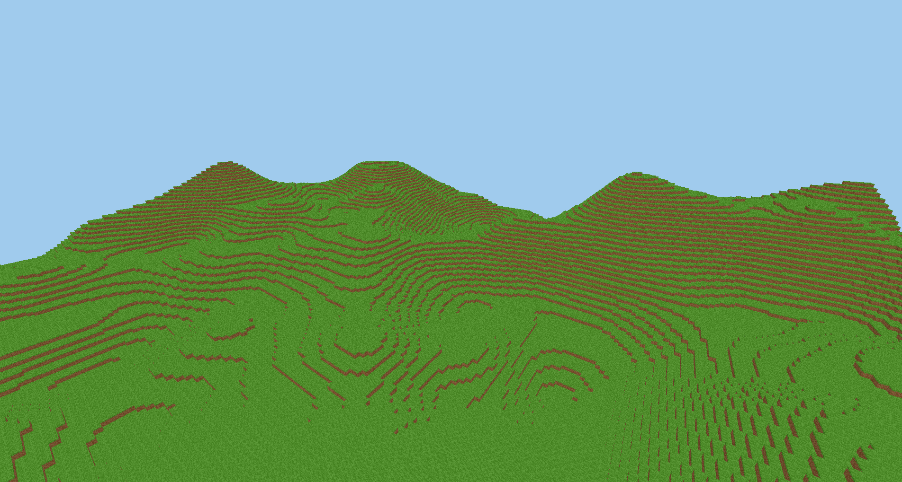

# VoxelCraft — v0.8.2 release candidate

Linux VoxelUI continuation: [build repair, profiling and upload lifetime work](docs/voxelui-linux-v1.md),
[measured latency](docs/voxelui-latency-baseline.md) and [memory audit](docs/voxelui-memory-audit.md).
The native DrawList Vulkan backend remains pending; the current path retains CPU rasterization.

A C++23, SDL3 and Vulkan 1.3 voxel sandbox foundation. Windows is the primary release
target; development and hardware rendering verification currently run on Linux.

v0.8.2-rc1 adds scalable Latin/Cyrillic fonts, a themed UI, searchable all-item
creative inventory, survival drag/split/quick transfer, readable crafting, UI scale,
a pause menu and a shared command console. `/help`, `/give`, `/gamemode`, `/tp`,
`/summon`, `/time` and utility/admin commands execute real game operations locally
or on the authoritative server. Authenticated operator roles persist separately.
World/region format 1 and mod API 1 remain compatible; player versions 1..9 migrate
to version 10. Network protocol 4 requires matching client/server versions.
Windows execution remains unverified; this is a release candidate, not a stable
release. See the [implementation/test record](docs/v0.8.2-implementation.md),
[command reference](docs/v0.8.2-commands.md), [UI guide](docs/v0.8.2-ui-design.md)
and [release notes](docs/v0.8.2-release-notes.md).

The [modding foundation](docs/native-modding.md) adds an installable C/C++23 SDK,
explicit trusted DLL/SO loading, declarative content and deterministic resource
providers. The samples run through real game commands, inventory, saving and
rendering. Native code has process privileges. The optional
[VoxelUI integration](docs/vulkan-ui-integration.md) now runs XML/CSS/SVG menus,
connection editing, status/error screens, the mode/health HUD and pause controls
in local and multiplayer sessions. Its reference bridge presents changed software
surfaces through the existing Vulkan device. Hotbar icons, inventory, crafting,
settings and console retain the existing UI; a native GPU DrawList backend is a
separate next task. Enable it
with `VC_ENABLE_VOXELUI=ON` and an explicit `VC_VOXELUI_SOURCE_DIR` or installed
VoxelUI 0.2.1 package.

The [application/session split](docs/client-sessions.md) adds no-world menu
startup, repeatable local/remote sessions and save/disconnect back to menu while
retaining the same renderer. Its [verification](docs/client-sessions-results.json)
is separate from the earlier baseline results.

The [modular core foundation](docs/modular-architecture.md) documents the CPU
module split, persistence service and compile-time mesher selection. See its
[verification gate](docs/modularization-progress.md) and
[ClientApplication/GameSession handoff](docs/next-milestone-client-sessions.md).

The [baseline recovery record](docs/baseline-recovery.md) documents the original
files omitted from earlier commits, their provenance and clean-checkout checks.


Implemented: seeded procedural grass/dirt/stone terrain, compact 32³ chunks,
neighbor-aware cube meshing, textured rendering with depth testing, a
first-person camera, window resize/minimize handling, and diagnostics.
The v0.1 viewer implementation is complete. The v0.2 interactive slice adds
six-block ray selection, a crosshair and selection outline, block destruction and
placement, chunk mesh updates, and walking with gravity, jumping and collision.
Free flight remains available with F or `--fly`.
The v0.3 sandbox slice adds versioned world saving/loading, compressed region files,
player-state persistence, automatic/F5 saving, frustum culling and bounded background
terrain generation, a nine-slot creative hotbar and an interactive block catalog.
The default generator-v3 initial scene contains 294 chunks. Terrain streams around the player
horizontally and vertically, with a bounded resident region and retained edits.
The active v0.4 slice adds optional survival play: item quantities, a backpack,
timed mining, crafting, wooden/stone pickaxes, durability, fall damage and respawn.
New worlds include trees and coal/iron deposits; older worlds retain their generator.
The v0.5 expansion adds plains/forest/desert/mountain biomes, caves, rivers, snow,
small stone ruins, static transparent water and swimming. A 20-minute day/night
cycle, distance/underwater fog and propagated craftable lamp light are implemented.

The v0.6 living-world foundation adds wandering grazers, night-stalking enemies,
voxel-colliding EnTT actors, timed melee combat, dropped loot and food healing.
Animated models use reusable instanced Vulkan geometry. Creatures and loot save
with the world. This is basic AI; pathfinding and an ecosystem remain planned.

The v0.7 modding foundation connects declarative block/item/recipe packs and
controlled Lua hooks to play and world persistence. Try `--mods-dir examples/mods`
from the repository root; E exposes the demo glowstone block, and survival crafting
uses mouse-wheel pages for additional recipes. Packs can supply 16×16 PNG
textures, tool-tier/drop rules and explicit saved-state migrations. See the [mod guide](docs/modding-design.md)
and [crafting capture](docs/voxelcraft-v07-crafting.png).

The v0.8 multiplayer foundation adds a dedicated headless server and connected
Vulkan client. Up to eight players share streamed terrain, day/creatures and mod
content. The server owns movement, edits and survival progression; separate named
profiles save health, inventory, hotbar and pose. See the
[multiplayer guide](docs/multiplayer.md) and [two-player capture](docs/voxelcraft-v08-players.png).

```sh
./build/debug/bin/voxelcraft-server --world-dir worlds/friends --survival
./build/debug/bin/voxelcraft --connect 127.0.0.1 --name Alice
```

Blocks use a procedural 16×16-pixel atlas with grass, dirt, stone, log bark/end grain,
planks, leaves, cobblestone, coal/iron ore, sand, sandstone, snow, water and lamps. Nearest sampling preserves the pixel style; mipmaps are
not implemented, so distant textures can shimmer.



The [v0.2 selection capture](docs/voxelcraft-v02.png) shows the crosshair and block outline.
The v0.3 [hotbar](docs/voxelcraft-v03.png), [inventory](docs/voxelcraft-v03-inventory.png)
and [settings](docs/voxelcraft-v03-settings.png) captures show the historical v0.3 UI.
The current [creative catalog](docs/voxelcraft-v082-inventory.png) and
[console](docs/voxelcraft-v082-console.png) use the v0.8.2 font/theme system.
The [streaming capture](docs/voxelcraft-v03-streaming.png) follows a saved-world revisit.
Current survival captures show [timed mining](docs/voxelcraft-v04-mining.png),
[crafting](docs/voxelcraft-v04-crafting.png) and [death](docs/voxelcraft-v04-death.png).
The [generator v2 capture](docs/voxelcraft-v04-terrain.png) shows natural trees.

World expansion captures show a [river](docs/voxelcraft-v05-river.png),
[desert](docs/voxelcraft-v05-desert.png), [snow](docs/voxelcraft-v05-snow.png),
[ruin](docs/voxelcraft-v05-ruin.png) and [lamp lighting](docs/voxelcraft-v05-lamp.png).
Water is static; flow, drowning, angled sun shadows and precise transparency
sorting remain planned. `--time 0..1 --freeze-time` provides repeatable lighting;
0 is sunrise, .25 noon, .5 sunset and .75 midnight. New worlds use generator 3;
`--generator-version 1..3` selects an older generator only when creating a world.

The [creature capture](docs/voxelcraft-v06-creatures.png) and
[combat loot capture](docs/voxelcraft-v06-combat.png) come from the strict SDL test.
Grazers drop raw meat (heals 3); stalkers drop coal. Attacks reach three blocks,
respect terrain occlusion and wear tools. Stalkers attack survival players at night.
Loot stays when inventory is full. The current limits are 32 creatures and 32
drops; at the drop limit a killing blow is refused until loot is collected. Far
creatures despawn; distant drops remain saved and resume when terrain is resident.

## Build and run on Linux

Required: CMake 3.25+, Ninja, Git, a C++23 compiler, Vulkan 1.3 headers and loader,
`glslc`, and SDL's X11 and/or Wayland development prerequisites. A Vulkan 1.3
graphics driver and desktop session are needed to run the client. No OpenGL
renderer or software fallback is provided.

By default CMake fetches SDL 3.2.10, GLM 1.0.1, EnTT 3.14.0, Lua 5.4.9,
nlohmann/json 3.12.0 and GoogleTest 1.16.0 into the build tree. The first configure needs network access. No system packages are installed
by CMake. See [building](docs/building.md) for prerequisite packages and alternatives.

```sh
cmake --preset debug
cmake --build --preset debug --parallel 4
ctest --preset debug
./build/debug/bin/voxelcraft
```

To use installed SDL3, GLM and GoogleTest instead, configure with
`cmake --preset debug -DVC_USE_SYSTEM_DEPS=ON`. This also requires installed
nlohmann/json 3.12.0; Lua is always fetched and built as C++. EnTT uses an exact
installed 3.14.0 package or fetches that version. `release` and `relwithdebinfo`
presets are also available.

## Build on Windows

Install Visual Studio 2022 with C++ tools, CMake, Git and the Vulkan SDK (including
`glslc`). Open a fresh developer terminal with `VULKAN_SDK` set:

```powershell
cmake -S . -B build/windows -G "Visual Studio 17 2022" -A x64
cmake --build build/windows --config Release --parallel 4
ctest --test-dir build/windows -C Release --output-on-failure
.\build\windows\bin\Release\voxelcraft.exe
```

The Windows workflow is configured but has **not** been executed or verified in
this Linux development session. Windows compilation and runtime are unverified.

## Controls and options

| Control | Action |
| --- | --- |
| W / A / S / D | Walk forward / left / backward / right (fly in flight mode) |
| Mouse | Look around |
| Space | Jump when grounded; swim upward; ascend in flight |
| Left Shift | Swim down; descend in flight |
| F | Toggle walking / free flight |
| F5 | Save the current persistent world |
| F10 | Settings: field of view, sensitivity, inverted mouse Y and UI scale |
| Left click | Mine/remove the targeted block, or attack a nearby creature |
| Right click | Place selected blocks, or eat selected meat when injured |
| 1–9 / mouse wheel | Select a hotbar slot (initially grass / dirt / stone in 1–3) |
| E | Open/close creative inventory; search/category/filter and click any item to assign the selected slot |
| E in survival | Backpack; drag to move, right click to split, Shift click to quick transfer |
| C in survival | Open/close crafting; click an available recipe |
| R after death | Respawn at a clear origin-area surface; keep inventory |
| Right click a hotbar slot in inventory | Clear creative assignment / transfer survival stack to backpack |
| Escape | Return from UI; open Pause in gameplay |
| Left click while released | Capture the mouse without editing terrain |
| /, T, grave | Commands, chat, expanded console; Enter submits, Tab completes |
| Up/Down in console | Bounded command history; Ctrl A/C/X/V and UTF-8 editing |
| Window close | Save and exit |
| Ctrl+Shift+Q | Explicitly exit without saving |

The player spawns on the terrain in walking mode. Jump over one-block steps;
automatic stepping and crouching are not implemented. The camera starts captured.
Released capture/focus stops movement commands and edits; gravity continues except in solo Pause/Settings.
Flight permits passing through terrain, but switching back to walking is rejected
while the player overlaps solid blocks or unavailable chunk data. Placement cannot
overwrite an occupied cell, leave the resident world/height bounds, or overlap the
player body. Edits are single-click actions; there is no held-button repeat yet.
The default creative inventory supplies non-consuming assignments for every registered item, including tools. Empty slots
cannot place blocks. The visible hotbar uses actual per-face atlas materials;
inventory pages scroll with the wheel. Creative slots do not track quantities;
survival uses the separate stack inventory described below. Movement commands stop
while inventory is open; gravity continues.

## Survival foundation

Start a separate world with `--survival --world-dir /path/to/survival-world`.
The saved mode resumes automatically; `--creative` explicitly changes back.
Hold left click to mine. Selection/release/focus or changing the equipped slot
resets mining progress; recapture clicks never start mining. Right click places
one block from the equipped stack. Flight is disabled in survival.

Gather two logs, press C, craft planks twice, sticks once, then a wooden pickaxe.
Select the tool in the hotbar and mine three stone blocks for cobblestone. Craft a
stone pickaxe using cobblestone and the remaining sticks, then harvest iron ore.
Stone/coal require a pickaxe for drops; iron needs a stone pickaxe. Tools wear when
blocks break. Bare hands can break stone slowly but produce no stone drop.

The backpack holds 27 stacks in addition to nine hotbar slots. Most items stack to
64; tools stack to one and retain individual durability. In the backpack, left
click swaps with the selected hotbar slot, right click transfers one item, and
right click on a hotbar slot moves it into the backpack. Full inventories block
resource collection without destroying the block. Crafting checks all ingredients
and output space before consuming anything.

Health starts at 20. Falls beyond about three blocks cause damage. R respawns after
death with inventory kept. Unknown streamed data pauses vertical movement without
acting as a real floor, causing damage or allowing jumps. Hunger, smelting, leaf drops and health regeneration remain future work.
Creatures, combat, dropped loot and food healing are implemented as described above.
Coal and iron are collectible resources; iron tools/smelting are not yet implemented.

Settings changes apply immediately and save under the user-data directory, with a
previous-file backup and checksum validation. `--settings-file PATH` selects a
configuration, `--no-settings` keeps settings temporary, and `--fov 50..110`,
`--sensitivity 0.0005..0.01`, `--invert-y` / `--normal-y` override the current run.
Bounded/smoke runs ignore user settings unless an explicit settings file is given.

```sh
./build/debug/bin/voxelcraft --seed 42 --radius 3 --min-y -512 --max-y 511
./build/debug/bin/voxelcraft --smoke --screenshot /tmp/voxelcraft.ppm
./build/debug/bin/voxelcraft --fly
./build/debug/bin/voxelcraft --world-dir /path/to/my-world --seed 42
./build/debug/bin/voxelcraft --no-save
./build/debug/bin/voxelcraft --survival --world-dir /path/to/survival-world
```

`--radius` accepts 1..6 horizontal chunks around the player. World height bounds
are inclusive and configurable. Streaming retains the surface band Y=-32..63
(clipped to world bounds) and the player's vertical chunk plus one above/below.
It generates near chunks first on a bounded worker and integrates at most two per
frame. Edited chunks survive eviction in a compact cache and are restored on revisit.
`--frames N` exits after N presented frames. `--screenshot` saves a PPM of the last
bounded frame (or frame 61 in an unbounded run). Assets are found beside the
executable, independently of the working directory.

The title and log show FPS, frame time, camera coordinates, loaded/drawn chunks
and terrain triangle counts (submitted/total), movement mode, selected material and targeted block.
Logs go to standard error. `--smoke` runs 120 frames, checking jump/landing,
removal/restoration at a negative chunk seam, GPU mesh creation/removal, resizes,
mouse capture changes and minimize/restore, then saves an image and exits.
It requires a real display and Vulkan driver;
window managers may adjust or ignore requested window sizes.

## Saved worlds

Normal play creates or resumes `worlds/sandbox` under SDL's writable application
data directory, logged on save. `--world-dir PATH` selects a separate world;
`--seed`, `--min-y` and `--max-y` configure new worlds and conflicting values are
rejected when reopening. F5 saves during play or inventory, autosave runs every 60 seconds,
and clean exit saves the world and player position, orientation, movement mode and
hotbar assignments and selected slot. `--no-save` creates a temporary world. `--frames` runs are temporary
unless `--world-dir` is explicit; smoke runs are always temporary.
Survival mode, health, all item stacks and tool durability are also persisted.
If saving fails during a normal close, the window stays open with the world in
memory. F5 retries; Ctrl+Shift+Q explicitly discards unsaved changes and exits.
`--generator-version 1..3` selects generation for a new world; reopening always
keeps its recorded version. Version 1 terrain has no natural trees or ores.

Each commit writes palette/RLE-compressed 4³-chunk region files and metadata into
a new snapshot directory, then renames that directory into place. The previous
snapshot is retained. Checksums and bounded decoding reject damaged/unsupported
data; a corrupt newest snapshot fails explicitly instead of silently rolling back.
Unknown block names retain their identifiers and appear as solid magenta cubes.
An OS-owned session lock prevents concurrent writers and releases after a crash.
This protects against interrupted processes; power-loss durability is not guaranteed.
New saves store edited chunks; untouched generated terrain is recreated from the
recorded seed/version. Legacy snapshots containing full resident regions remain
readable and their chunks are retained. The edit cache grows with edited chunks;
the current snapshot limit is 8,192 saved chunks. Resident terrain stays bounded.
See [world format](docs/world-format.md) for layout, limits and recovery.

## Verification and limitations

The [2026-10-29 continuation](docs/development-session-2026-10-29.md) built the
full client with GCC 16.2.1 and Clang 22.1.8: 115 CPU/CLI tests passed with each,
including Clang ASan/UBSan/leak checks. All eight strict graphics tests passed
on AMD Radeon Graphics (RADV RENOIR), using isolated Wayland for seven interactive
tests and X11 for automatic minimize/restore; zero Vulkan diagnostics. The timed continuation later added PNG assets, mining rules and schema migrations:
128 CPU/CLI tests passed with GCC and Clang sanitizers, and all eight graphics
tests passed together on isolated Wayland after the restore fix.
Windows/manual playtests remain unverified.

GCC and Clang builds and CPU tests pass on Linux. A hardware smoke test on an
NVIDIA RTX 3050 rendered terrain, captured an inspected image and shut down
cleanly. Detailed build, sanitizer and rendering evidence is recorded in
[v0.1 verification](docs/verification.md) and [v0.2 verification](docs/verification-v02.md).

Core and synchronization validation passed on the RTX 3050 with a project-local
Khronos layer: zero errors and warnings, including shutdown. Debug builds enable
available layers automatically. `--require-validation` also enables them in
Release and fails if they are unavailable; reported errors fail the run. See
[graphics testing](docs/building.md#assets-and-graphics-testing) for opt-in CTest integration.
Rendering culls terrain meshes outside the camera frustum and reports actual
submitted draw counts. Initial generation uses one bounded CPU worker; window
close/resize remain responsive during that phase. Rendering uses one frame in flight, staged atlas upload and direct host-visible mesh
uploads. A near-first queue normally rebuilds at most two chunks per frame (four
for an edit); removed GPU meshes are always cleared. Generation and meshing use
bounded workers with owned snapshots and revision tickets. Opaque full cubes merge
compatible faces and repeat atlas tiles; transparent cubes retain unit faces.
Mesh/HUD replacement waits for the single submitted frame fence. Mipmaps remain
future work. Connected play smooths server positions without movement prediction.
Snapshot serialization and disk synchronization run on one bounded worker; capture
and full-world lighting still run on the main thread. Unavailable chunks
temporarily block walking until the streaming worker fills them.
The application supports cube blocks, including a separate transparent stream.
Mod PNG textures append to the shared atlas; built-in tile indices remain fixed.

Code is split between `engine/platform`, `engine/renderer`, `engine/voxel`,
`game/player`, `game/gameplay`, `game/content`, and the composition root in `client`.
CPU tests are
in `tests`, shaders in `assets/shaders`, and CI in `.github/workflows`.
See [architecture](docs/architecture.md), [world format](docs/world-format.md),
[modding design](docs/modding-design.md) and [ROADMAP](ROADMAP.md).

Next: execute Windows/MSVC archive and cross-platform LAN acceptance, then continue roadmap work;
explicit state migrations, harvest rules, PNG assets and a real server/client
connection are implemented in the current timed continuation. Windows and manual playtests
remain unverified. Project licensing has not been selected. The previous timed work
record is [the session log](docs/development-session-2026-10-28.md); continuation
work is recorded in [the handoff](docs/development-session-2026-10-29.md).
The active five-hour window is tracked in [its session log](docs/development-session-five-hour-2026-10-29.md).


## v0.8.2 packages and private hosting

```sh
cmake --preset release
cmake --build --preset release --parallel 4
ctest --preset release
cpack --config build/release/CPackConfig.cmake -C Release
python3 tests/package_smoke.py build/release/packages/*.tar.gz
```

Archives contain one executable each, compiled client shaders, bundled C++ runtime
libraries/DLLs, dependency notices, launch documentation and the optional demo mod.
Base textures and content are generated in the executable. Extract the entire
archive; no compiler or Vulkan SDK is needed at runtime. Linux's glibc baseline
matches the build host (CI targets Ubuntu 24.04). A Vulkan 1.3 driver remains
required by the client. Run the extracted executable from any working directory.

The default server bind remains loopback. For private network hosting use
`--bind 0.0.0.0 --auth-file /private/identities.txt`; each line is `NAME TOKEN`,
where TOKEN is a privately shared random 64-character lowercase hex value.
Clients use `--connect HOST --name NAME --identity-file /private/player.token`.
The client file contains only its token. See [hosting](docs/multiplayer.md) for
creation, rotation and trust limits. Unauthenticated external binds require
explicit `--trusted-lan`. TCP is unencrypted; use a trusted LAN or secured tunnel.

Ordinary display configuration is available without source edits:
`--width 1280 --height 720 --fullscreen` / `--windowed`, `--vsync` / `--no-vsync`,
`--radius 1..6`, `--fov`, and `--sensitivity`. Audio is not implemented.
The F10 settings menu persists FOV, sensitivity and invert-Y in the user directory;
display/radius options are startup overrides. `--help` lists launch options.

Fonts are embedded in the client and bundled with redistribution notices; no OS
font or font development library is required. See [build instructions](docs/building.md).

Linux VoxelUI native-backend progress and reproducible checks are recorded in the
[native geometry continuation](docs/voxelui-native-geometry-continuation.md).
The application currently retains the software-surface bridge.

Native UI progress: [primitive Vulkan renderer and current test selection](docs/voxelui-native-primitives.md).
That primitive-only report is historical; the native v1 report below supersedes it.

Linux native VoxelUI is enabled by default with `VC_ENABLE_VOXELUI=ON`; it requires
an optional `VoxelUI::vulkan` package or the current sibling source checkout.
[Native renderer, measured latency, build commands and remaining work](docs/voxelui-native-v1.md).
Use `VC_VOXELUI_NATIVE=OFF` explicitly for software-reference comparison.
