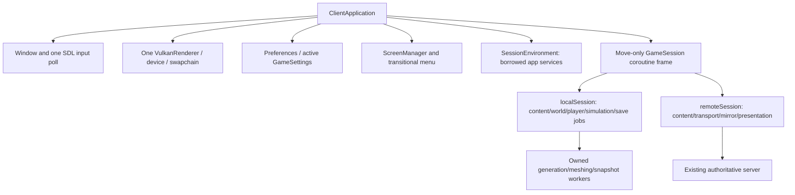

# ClientApplication and GameSession (Milestone 2)

Implemented on `feature/client-sessions`, based on the independently verified
Milestone 1 commit `9c9a1d7`. The original worktree's separate
`feature/modular-core-m1` implementation and VoxelUI are untouched. This phase
implements application/session ownership and transitional navigation; it does
not introduce VoxelUI, native mods, new save formats or the SVG redesign.

## User flow

Running `voxelcraft` opens a menu without constructing a World, opening a world
directory, generating chunks or starting a network connection. Play sandbox
creates/loads the configured local world (default user-data `worlds/sandbox`).
The server-address/name fields and Connect action use the real existing protocol.
Tab/Shift-Tab, Enter, mouse and bounded UTF-8 editing use the existing input/editor
services. Errors expose a recoverable Back route and are logged in full.

The legacy pause screen adds **Return to main menu**. Local leave saves before
releasing the world; remote leave disconnects the transport. Both return to a
usable menu in the same process. Settings edited in a session update the
application's active settings and use existing validated atomic persistence.
They survive subsequent sessions, including sessions with different mod atlases.

Explicit `--world-dir`, `--connect`, and bounded `--frames`/`--smoke` invocations
still start directly. Bounded runs exit when complete and fail on session errors,
preserving existing CLI, process and package tests. Interactive startup errors
return to an error screen. World selection/creation management and a complete
settings/mod/resource-pack frontend remain later UI work.

## Actual ownership and interfaces



`client/application.hpp` exposes construction, `run`, individual `frame(Input)`
ticks, `startLocal/startRemote`, leave/quit requests, state/settings queries and
explicit renderer shutdown/validation reporting. `ScreenManager` represents
MainMenu, Loading, Gameplay, Saving and Error. Gameplay overlays continue to use
`SandboxUiController`; it does not own application navigation.

`client/game_session.hpp` is a small standard C++23 coroutine owner. Its promise
starts suspended; `resume()` advances one application tick; `result()` reports
Menu/Quit/Completed or rethrows a captured failure. The unique frame stores the
existing algorithms' ordinary local variables across frame yields. It is
noncopyable/movable and destroys the frame exactly once. There is one coroutine
allocation per session, no per-frame coroutine allocation and no per-voxel dispatch.
See [the ownership decision](decisions/0015-client-session-lifetimes.md).

`SessionEnvironment` borrows Window, renderer, preferences and ScreenManager. Its
`nextFrame()` yields and then moves the application-provided Input snapshot into
the session. `ClientApplication::run()` is the **only SDL polling loop**. Initial
terrain generation, mesh preparation, remote handshake, gameplay and final save
all yield to it; no session performs a nested poll loop. Resize/quit/cancellation
are routed by the application, and activating menu input is cleared at transition.

`client/local_session.cpp` contains the local gameplay implementation extracted
from main; `client/network_client.cpp` contains the remote session. Their existing
player/inventory/crafting/survival/actor/command and protocol algorithms remain.
Content is session-owned, registered before palette resolution and rebuilt before
inventory restoration. Remote mutation remains intent sent to the existing host.
Local and remote sessions do not duplicate authoritative simulation.

The application constructs Window, preferences, renderer, navigation and environment
before the session owner, and destroys the session first. Inside each coroutine,
normal declaration-order RAII destroys UI/callbacks before their borrowed gameplay
state, joins workers before their data and releases the snapshot writer before its
WorldStore. A completed/cancelled frame owns no callbacks retained by the application.

## Save, cancellation and error rules

Local leave freezes simulation, drains any prior save, captures the final state,
requests an owned snapshot and yields while waiting for its result. Only successful
completion permits destruction/lock release. On a save failure the live world
remains active for retry; the quit request is cancelled and the existing diagnostic
is shown. Ctrl+Shift+Q remains an explicit discard action. A bounded CLI run reports
final save failure instead of waiting indefinitely for interactive recovery.

Escape/cancel while generating/preparing terrain or handshaking releases partial
session state and joins workers. New sessions use a new frame and content runtime,
so stale jobs/results cannot address a later World. Accepted snapshot jobs still
complete before their store lock is released. `shutdown()` rejects a live session:
call leave/quit and pump until completion first. Destruction is a nonthrowing
resource cleanup fallback, not a substitute for observing save results.

Expected load/connection errors reach the application Error route; network loss
does not make the client mirror authoritative. Unexpected session exceptions end
that session and are reported; prior committed snapshots remain available. Routine
save errors use the recoverable in-session path above.

Synchronous bounded metadata/content parsing and DNS/address resolution remain
synchronous operations; cancellation is checked between those operations and during
frame-driven generation/meshing/handshake work. There are no detached threads.

## Renderer boundary

`VulkanRenderer::clearSession()` retires terrain, models, instances, HUD, selection
and progress, and resets atmosphere. `replaceAtlas(ImageRgba)` validates input,
waits for the existing frame fence, creates/uploads a replacement, updates binding
0 and then releases the old texture. Creation failure leaves the old texture in
place. The existing upload queue wait and single-frame fence protect descriptor
and image lifetimes. The font binding remains independent.

The window, Vulkan instance/device/swapchain and font cache persist across sessions.
No second graphics context is created. Uploaded data is renderer-owned; it does
not borrow CPU content after a session dies. These are lifecycle operations, not a
VoxelUI backend or a new frame-in-flight/synchronization design.

## Verification

Current run evidence is retained at `/tmp/vc-client-sessions-e4lz4w4_` (a link to
disk-backed cache storage after `/tmp` exhausted its 7.6 GiB capacity). No sources,
user data or prior evidence were deleted. Dependency sources are the explicitly
selected pristine pinned checkouts; all build outputs are separate from prior runs.

| Check | Current result |
| --- | --- |
| Fresh GCC full client/server configure/build | Passed |
| CPU/CLI suite, including three coroutine ownership/error/save-lock tests | **219/219 passed** |
| Full SDL/Vulkan suite, including Client.Sessions | **13/13 passed** |
| Extended lifecycle test with mod atlas and persisted settings | Passed |
| Clang ASan/UBSan CPU/CLI, leak detection enabled | **219/219 passed** |
| Clang TSan worker/snapshot/session selection | **17/17 passed** |
| ASan/UBSan Client.Sessions, leak detection disabled | **1/1 passed**, no ASan/UBSan findings |
| GPU LeakSanitizer probe | Failed: one 128-byte allocation from an unloaded module, also reproduced by Client.Environment without application/session code |
| Committed-source clean GCC client/server build and CPU/CLI suite | **219/219 passed**; **192** project inputs tracked, no working-source references |
| Independent client OFF/testing OFF server target + 30-tick run | Passed; no application/renderer/UI/meshing in target commands |
| Clean graphics suite | **13/13 passed**; enriched Client.Sessions repeated successfully at `e6397fb` |
| Extracted client/server TGZ packages | Both CPU/runtime checks and extracted-client `--gpu` check passed |

The GPU leak report's exact module remains unresolved. Its reproduction in the
existing direct-renderer control does not establish a new session leak; it also
does not establish a clean GPU leak check. No suppression was added. CPU leak
checks stay enabled. Other ASan/UBSan errors were not observed in the CPU run.

The lifecycle playtest verifies no world is opened by the menu, generation cancel
and lock release, three local save/load/leave cycles in one process, save I/O failure
and retry retaining the world, the actual fourth pause button, active/persisted
settings, a different mod atlas/state, a recoverable saved-seed mismatch, two real
remote connect/disconnect cycles, handshake cancellation, content-mismatch rejection
and error/back recovery. It checks geometry
removal, the same renderer owner and zero Vulkan errors/warnings through shutdown.
Actual menu and error captures are generated; the main-menu and saved-seed-error
captures were visually inspected. Exact outcomes are also in [machine-readable results](client-sessions-results.json). Existing graphics tests retain gameplay, survival,
network, inventory, console, persistence and renderer lifecycle coverage.

Reproduce from the repository root:

```sh
cmake -S . -B build/sessions -G Ninja -DCMAKE_BUILD_TYPE=Debug -DVC_ENABLE_GPU_TESTS=ON
cmake --build build/sessions --parallel 3
ctest --test-dir build/sessions -LE graphics --output-on-failure --no-tests=error
# Requires display/device and Khronos layer; use an isolated display if available.
ctest --test-dir build/sessions -L graphics --output-on-failure --no-tests=error
cmake --preset asan-ubsan
cmake --build --preset asan-ubsan --parallel 3
ctest --preset asan-ubsan --no-tests=error
cmake --preset tsan
cmake --build --preset tsan --parallel 3
ctest --preset tsan --no-tests=error
```

The executed ASan build additionally enabled the client/graphics tests, selected
Clang for C and C++, and ran CPU tests with `detect_leaks=1:halt_on_error=1` and
UBSan `halt_on_error=1:print_stacktrace=1`. The separate GPU memory-safety rerun uses
`detect_leaks=0` and retains the failed leak-check evidence. TSan uses
`halt_on_error=1` and the updated preset selection including `GameSession`.

The full clean build/test source is committed code `34b2d0f`; the additional remote
rejection assertions are committed at `e6397fb` and were rebuilt/run from that clean
worktree. The final documentation commit changes no implementation. Source audits
found 192 compiler-resolved project inputs, all tracked, and no references to the
working source tree. Both repository tracking audits have zero findings. User task
notes, main, the alternative feature branch and VoxelUI remain unchanged.

Packaging reproduction:

```sh
cpack --config build/sessions/CPackConfig.cmake -C Debug
python3 tests/package_smoke.py build/sessions/packages/*.tar.gz
python3 tests/package_smoke.py --gpu build/sessions/packages/*.tar.gz
```

Nonblocking build diagnostics include the pinned SDL discarded-const warning with
GCC 16 and GLM CMake deprecation notices. The initial sanitizer link attempt ran
out of `/tmp` space; moving only this run's generated build/evidence directory to
disk-backed cache and preserving its original symlink path resolved it. The resumed
build and tests passed, subject to the separately recorded GPU leak probe failure.

No GPU timestamp, allocation-count or frame-time benchmark was run in this phase;
the voxel algorithms and worker job payloads are unchanged. Windows/MSVC and
sustained human play remain unverified. Native SDK, VoxelUI Vulkan/design/full UI
migration remain later milestones. Next work can build native lifecycle contracts
against the explicit application/session/content owners without a new global locator.
