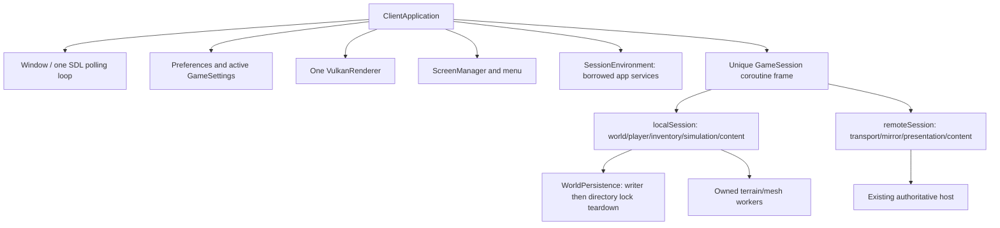

# ClientApplication and GameSession

Milestone 2 is implemented on `feature/client-sessions-next`, after the
[Milestone 1 gate recheck](modular-core-gate-recheck.json). The frame-driven
session implementation already existed on `feature/client-sessions` (`34b2d0f`,
`e6397fb`, tip `304432d`). It was reviewed and adapted rather than discarded or
duplicated. That branch, its independent foundation and existing worktrees remain
untouched. This branch retains the recovered baseline, `WorldPersistence` and the
compile-time mesh selection from `4f9c1b3`.

## User-visible behavior

Starting without a world/connection opens a real menu without opening a save,
constructing a world, generating terrain or connecting to a server. Play sandbox
creates/loads the configured sandbox; address/name fields connect through the
existing protocol. Mouse, Tab/Shift-Tab, Enter and bounded UTF-8 editing work through
existing input/editor services. Loading and connection errors have a Back route.

The legacy Pause screen adds **Return to main menu**. Local leave waits for a
successful save before releasing state and lock. Save failure retains the live
world for retry; Ctrl+Shift+Q remains explicit discard. Remote leave disconnects;
it never saves its mirror as an authoritative world. Repeated sessions reuse one
Window, renderer, Vulkan device and swapchain owner. Session settings update
application preferences and existing atomic settings storage.

Explicit `--world-dir`, `--connect`, bounded `--frames` and `--smoke` commands
continue to start directly, preserving process/package tests. Bounded failures
remain process failures. World management and the full settings/mod/resource-pack
frontend remain later UI work; this milestone uses a transitional legacy menu.

## Concrete APIs and ownership

`client/application.hpp` exposes construction, `run`, `frame(Input)`,
`startLocal/startRemote`, leave/quit requests, state/settings queries and explicit
renderer shutdown/validation. `ScreenManager` owns MainMenu, Loading, Gameplay,
Saving and Error routes. Inventory, crafting, console and pause overlays remain
in `SandboxUiController` until their replacement reaches parity.

`GameSession` is a move-only standard C++23 coroutine owner, initially suspended.
`resume` advances one application tick; `result` reports Menu/Quit/Completed or
rethrows a captured exception. The frame owns the original algorithms' local
values across yields. Its one allocation occurs at session creation, not for
each frame or voxel. Reset/destruction unwinds locals once in reverse order.
The application declares the session last so it dies before borrowed app services.

`SessionEnvironment` borrows Window/renderer/preferences/routes; `nextFrame`
yields and moves the next application's input snapshot into the session. Only
`ClientApplication::run` polls SDL. Generation, initial meshing, handshake,
gameplay and saving all yield; there is no nested save/input loop. Cancellation
joins owned workers and releases the session lock. New sessions have fresh frames,
content runtimes and result queues, so old work cannot mutate a new world.

`ContentServices` (`vc_session_content`) owns blocks, ModRuntime, items, recipes
and mining. It installs packs before saved/network palette resolution and rebuilds
gameplay values before restoring inventories. Its object references stay stable;
entry references/IDs must not survive rebuild. This target depends on modding;
the foundational voxel/gameplay targets still do not depend on Lua or graphics.

The local frame uses the existing concrete `WorldPersistence`, with owned save
snapshots, result polling and failure reporting. The copied mesher policies and
aliases remain host-selected through `vc_client_modules`; session extraction did
not revert to hardcoded workers. The remote frame reuses RemoteSession intent and
server snapshots without duplicating authoritative simulation.

Renderer `clearSession` waits through existing upload paths before clearing old
meshes/HUD/models/selection/progress. `replaceAtlas` waits for the current frame's
fence, builds the new texture, updates its descriptor and retires the prior texture.
No new instance/device/swapchain is created for session changes. Input transitions
clear held state, text focus and capture. Minimized menus skip zero-size layout;
diagnostics use bounded UTF-8-safe single-line text.

Normal leave/quit saves explicitly and observes errors. Destructor cancellation
is a resource-cleanup fallback, not an implicit promise to save unscheduled edits.
Unexpected session exceptions reach a recoverable Error screen; previous committed
snapshots remain available. No changes were made to save formats, content IDs,
protocol 4, Lua budgets or authoritative gameplay transactions.

## Verification and next boundary

[Results](client-sessions-results.json) record exact provenance/counts. GCC full
client/server and independent server-only builds pass. CPU/CLI: 227/227; Clang
ASan/UBSan with leak detection: 208/208; selected TSan ownership/worker tests:
19/19; full graphics suite: 13/13. The lifecycle playtest covers no-world startup,
cancel, three saved local sessions, save failure/retry, persisted settings,
modded sessions/atlas replacement, rejected load, two remote reconnects, cancelled
and rejected handshakes, cleared GPU geometry and strict shutdown validation.
The menu minimize/restore case settles the initial Wayland configuration first.
Actual menu/error/returned-menu captures were visually inspected.

Commands use the presets' existing Debug/graphics/server/ASan/TSan flags. The run's
fresh builds and raw logs are under `/tmp/vc-next-cuhcih49`; pinned dependency
sources are supplied explicitly from the existing cache. The clean checkout is
`source/` there. Source changes after the initial fresh configuration are rebuilt
incrementally, with committed-source provenance recorded in results. These local
artifacts may not persist. Windows/MSVC and new performance measurements were not
executed; no speedup, complete UI migration or release readiness is claimed.

Milestone 3 can add resource/data/native contracts through ModRuntime and the
session content owner. Native discovery must stay separate from trusted loading;
content registration precedes palette restoration, and callbacks must be removed
before DLL/SO destruction. Native SDK, VoxelUI backend, SVG theme and legacy UI
replacement are not implemented by this milestone.
