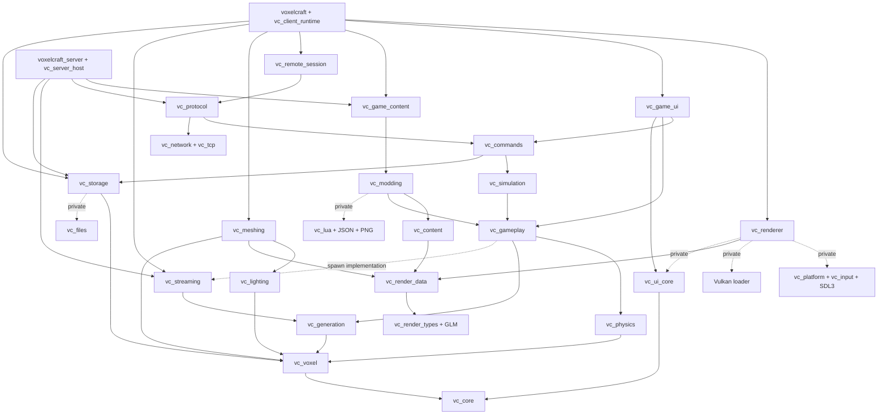

# Module dependency graph

Milestone 2 keeps these engine boundaries. `vc_client_runtime` now implements
ClientApplication, both coroutine sessions and the transitional menu. The executable
links only that composition library and its SDL platform entry support; see
[client sessions](client-sessions.md).

Arrows mean “depends on”. The build creates these targets; the diagram groups
small platform utilities, rather than creating a universal platform library.

## Direct target contracts

`vc_options` supplies C++23, warning/UTF-8/version/GLM convention options, without
runtime code. Common source-root includes are target-scoped. Existing names stay
where useful; names do not imply an installed ABI.

| Target | Public dependencies | Private dependencies / responsibility |
| --- | --- | --- |
| `vc_core` (`vc_text` alias) | `vc_options` | UTF-8, presentation validation and foundational headers |
| `vc_render_types` | `vc_options`, GLM | Header-only CPU mesh/image/atlas values |
| `vc_render_data` | `vc_render_types` | Texture/overlay/frustum algorithms |
| `vc_voxel` | `vc_core`, GLM | Registry/world/chunks; no rendering implementation, generation or workers |
| `vc_generation` | `vc_voxel`, Threads | Versioned terrain and bounded statically composed worker |
| `vc_streaming` | `vc_generation` | Residency, retained edits, generated sampling, near-first integration |
| `vc_lighting` | `vc_voxel` | CPU lighting/snapshots |
| `vc_meshing` | `vc_voxel`, `vc_lighting`, `vc_render_types`, Threads | `vc_render_data`; synchronous/background mesh production |
| `vc_physics` | `vc_voxel` | Collision/ray queries |
| `vc_storage` | `vc_voxel` | `vc_files`, Threads; formats and snapshot worker |
| `vc_content` | `vc_voxel`, `vc_render_data` | Built-in block/atlas/material/model policies |
| `vc_gameplay` | `vc_voxel`, `vc_camera`, `vc_physics`, `vc_generation` | `vc_streaming`; spawn validation, player/inventory/survival and game save values |
| `vc_simulation` | `vc_gameplay` | EnTT; day cycle/dynamic actors |
| `vc_modding` | `vc_gameplay`, `vc_content` | Lua, PNG, JSON; existing packs |
| `vc_game_content` | `vc_modding` | Content ownership/rebuild and network content fingerprint |
| `vc_commands` | `vc_simulation`, `vc_storage`, `vc_text`, `vc_files` | Commands, parser, permissions |
| `vc_protocol` | `vc_network`, `vc_gameplay`, `vc_simulation`, `vc_commands` | Strict codecs/identity; no Lua/mod runtime |
| `vc_remote_session` | `vc_protocol` | Transport and authoritative mirror |
| `vc_server_host` | `vc_protocol`, `vc_storage` | `vc_game_content`, `vc_streaming`; no meshing/UI/desktop |
| `vc_ui_core` | `vc_options`, `vc_text`, GLM | Bundled font rasterizer/embedded bytes, widgets, editor |
| `vc_game_ui` | `vc_gameplay`, `vc_settings`, `vc_ui_core`, `vc_commands` | Existing screens/console/HUD |
| `vc_renderer` | `vc_camera`, `vc_render_data` | `vc_platform`, `vc_ui_core`, Vulkan |
| `vc_client_runtime` | `vc_voxel`, `vc_network`, `vc_settings` | Renderer/platform/UI/session/storage/content/meshing/streaming composition |

The small files/settings/network/input/window/console/signal targets retain their
explicit existing links. `voxelcraft` now links its composition dependencies
directly, rather than inheriting them from client helpers. Playtests/benchmarks
explicitly link the meshing/streaming services they call.

## Enforced boundaries and independent builds

`cmake/ModuleBoundaries.cmake` checks actual direct `vc_*` target links recursively
at configure time. It rejects project cycles; game/UI/Lua/desktop links from CPU
engine mechanisms; generation/meshing/storage/render-algorithm links from world
storage; modding/Lua/desktop links from protocol; and meshing/UI/desktop links from
the server host. Private static-library dependencies are included. The checker is
deliberately limited to literal project target edges; review external dependencies
and any future conditional/generator-expression links separately.

`VC_BUILD_CLIENT=OFF` does not discover SDL or Vulkan. Headless testing still builds
legacy CPU UI regressions and mesher tests; that does not make them server runtime
dependencies. `vc_core_module_tests` links **only** `vc_generation` and GoogleTest.
`vc_core_module_example` adds `vc_meshing` to generate and mesh alternate terrain
without game, Lua, persistence or graphics code. With `BUILD_TESTING=OFF`, building
only `voxelcraft_server` does not compile CPU UI or meshing.

Generate a complete tool-produced graph with
`cmake --graphviz=build/debug/modules.dot -S . -B build/debug` after configuring.
See [verification commands/results](modularization-progress.md).
