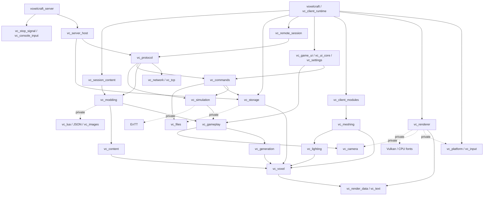

# Implemented module dependency graph

Arrows mean "links to / requires", not ownership. This sketch groups unchanged
small targets; the CMake target links are authoritative. See
[responsibilities and lifetimes](modular-architecture.md).



`vc_options` carries C++23, existing warnings, UTF-8/MSVC settings and GLM
conventions. GLM and standard library edges are omitted. Generation, storage and
meshing expose Threads because their public worker headers contain thread types.
`vc_voxel` no longer links Threads. `vc_storage` has no generation/mesh dependency.
`vc_generation` has no lighting/mesh dependency. Neither gameplay nor any CPU
core target links Lua, SDL, Vulkan or VoxelUI. Lua remains private to modding
(and therefore appears in the final server/client link, as required by current mods).

The former single voxel target had all three extracted branches inside it.
Server and gameplay consumers now avoid those unrelated edges. Sources were not
duplicated: each implementation translation unit belongs to one library. Two
built-in policy template instantiations live in `vc_meshing`; user policies can
instantiate in their consumer without changing queue implementations.

`cmake/ModuleBoundaries.cmake` runs on every configure. Four CTest cases verify a
valid graph and rejection of a cycle, graphics leakage and Lua leakage. Unknown
generator expressions in project link declarations fail explicitly, so a future
conditional edge cannot silently escape the check. The checker handles CMake's
private-static `$<LINK_ONLY:...>` wrapper. It does not introspect external package
internals, source includes or `add_dependencies` resource edges; CMake also checks
its build DAG. Shader/resource staging remains through `vc_shaders`/`vc_assets`.

To inspect the complete configured graph:

```sh
cmake --preset debug
cmake --graphviz=build/debug/modules.dot build/debug
cmake --preset server
cmake --build --preset server --target voxelcraft_server --parallel 4
```

The server preset does not discover SDL/Vulkan/VoxelUI. With tests enabled it also
builds headless CPU UI/mesh tests; that is separate from the server executable's
link closure. Use `-DBUILD_TESTING=OFF` for the smallest dedicated-server build.

## Milestone 3 additions

`vc_dynamic_library` is the platform-only DLL/SO mechanism (no SDL dependency).
`vc_native_modding` privately links that mechanism, `vc_commands`, the header SDK
and JSON; its public values depend on `vc_gameplay`. `vc_modding` privately owns
the native runtime beside existing Lua and keeps the same public content services.
`vc_resources` exposes owned bytes/providers with `vc_text` and private JSON.
The transitional `vc_game_ui` consumes it for validated resource themes.
`vc_client_runtime` owns the catalog; sessions borrow the validated Theme.
The headless server has no resource-theme, UI, SDL, Vulkan or meshing link edge.
`vc_mod_sdk`/`vc_mod_sdk_cpp` are installable header-only contracts and never link
engine implementation. The existing cycle/forbidden-dependency checks run on the
new targets at configuration, including the independent server build.
